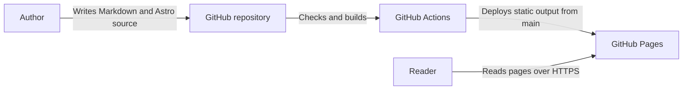

# Architecture

Astro generates static HTML and CSS, optimized local images, a sitemap, robots.txt, and a 404 page. Navigation uses native browser page loads without a client router or prefetching; the site loads no analytics or visitor tracking scripts.

Posts use a content collection to validate metadata. Their filenames determine URLs; drafts appear only in development, and published posts are listed by date. About is a single Markdown file imported directly by its page.

Markdown uses the unified processor with remark-math and rehype-katex for formulas, and Shiki for code highlighting. Keep this processor unless a replacement preserves the existing math and Markdown rendering.

GitHub Actions checks and builds pull requests and main. Only main can deploy to GitHub Pages. Deployment uses the domain root; subpath deployments and remote image processing are not configured.

The pnpm package extension for astro2tsx supplies its missing emnapi runtime dependency at the version matching its core. Without it, pnpm can pair core 1.x with runtime 2.x beta and `astro check` fails to load. Remove the extension when upgrading to an upstream version that declares a compatible runtime.

The direct KaTeX dependency provides the browser stylesheet and must stay on the same version as the renderer used by rehype-katex. Currently the plugins support KaTeX 0.16, so upgrading only the direct dependency to 0.19 would mismatch markup and styles.
