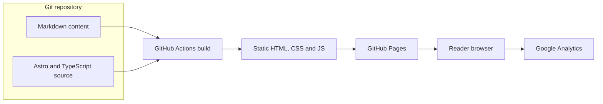

# Container Diagram

- Astro validates the content schema and generates post, About, sitemap, and 404 outputs.
- GitHub Actions runs type, lint, and formatting checks, then builds and uploads the static artifact.
- GitHub Pages serves the artifact; missing legacy tag URLs use the static 404 page.
- Readers navigate through native browser page loads without a client router or proactive page prefetching. Native CSS provides a shared single-column layout across viewport sizes.
