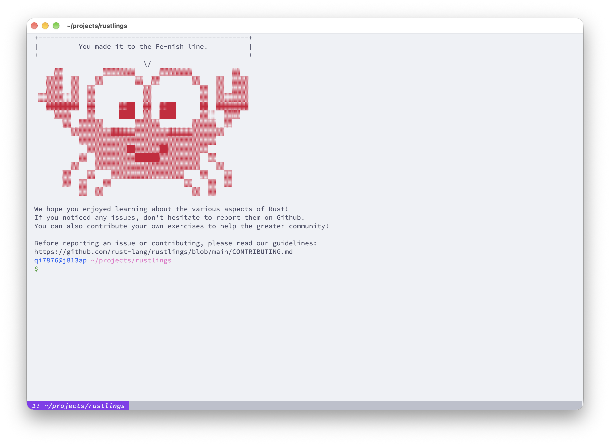

经过两三年的探索，大概知道了自己的方向：Multimodal LLMs, Agentic AI, and ML Systems

也知道了自身的问题：没有形成系统性的知识和思维，需要提升实践、工程、管理能力。在这种状态下，当然可以继续做科研，水论文抽奖，但这个时代不缺 slop，这样做没什么意义。

所以，该水还得水，没办法，但是也得提升一下自己，所以给自己最后的本科生涯做了点规划。

## ????-??

已经想不起来我具体是什么时候学了这些

计算机通识：大一上自己摸索，因为初中后就接触过 python，配合着 ChatGPT 上手还是很快的，这个时期主要在折腾网络、linux 服务器这些东西

李沐的 Deep Learning 书：大概是大一下，只学了一部分

missing semester：大一下的暑假

吴恩达的 AI 系列：大二下，只学了部分课程

CS61A：什么时候开始学已经想不起来了，貌似是大二上

CTF：大二上

单片机：大一下的工创，顺便实践了 C 语言

计算机网络：似乎是大二下，没认真听，但是实验还是认真做了，后面有时间了再补

数据库系统实验：老师是工业界出来的，工程能力很强，但是我又没好好听课

操作系统：大三上，没认真听，实验也没认真做，拿 AI 糊弄过去了，后面有时间了再补

还有一些零零散散的内容，比如 C 语言等等

## 2026-06

学完了 CS106L，感受是 C++ 的历史包袱实在是太重了

准备学习 CSAPP，看了 intro

开始准备夏令营

## 2026-07

继续忙夏令营，顺便在北京玩了几天

然后开始 nips 的 rebuttal，结束后继续学 CS61A

## 2026-08

结束了 CS61A，前前后后学了 2 年，终于断断续续的学完了

回家继续推进科研，然后度过最后 10 来天暑假假期

## 2026-09

学了目前软件工程的一些实践，日常多用用吧，不过有些观点也有很多批评的声音，还是得灵活一点。

24 号，the book 看到第 17 章了，加油，争取国庆前结束吧，把 final project 做了然后开始准备软工实验，后面就专注 CS61B 和 CSAPP

27 号，这几天学了一些项目管理的知识，并且用起来了，感觉不仅仅是为了推进项目才做项目管理，更是为了让项目往正确的方向走，do things right vs do the right things

29 号，the book 看到第 20 章了，最长信息量也最大的一章，加油，然后今天调整了一下计划清单

## 2026-10

1 号，the book 还剩最后一小节就到了 final project，然后又调整了一下课程清单

the book 的正文部分结束了！rustlings 也同步做完了！开启最后的 project！

2 号，结束了 the book，开始做上周 CS61B 的作业

3 号，状态不是很好，整理了一些资料，然后推进了点 CS61B

4 号，出去爬山了

5 号，CS61B 同步进度了，今天还尝试了使用 Jujustu colocated with Git，真的太好用了，比 Git 的 mental model 要简单很多（Git 的 stash 机制很反人类，staging area / index 也同样有些多余，jj 直接让 commit 作为 workspace，消除了这些复杂度），概念上也消除了 Git 瞎起名带来的误解（比如 branch，实际上只是个 reference，Git 使用 branch 让人很容易误解成是从 main 分叉出的一整条 commit 链，而在 jj 中，作者使用 bookmark 来指代）

6 号，推进 CSAPP 105 / 1076，明天准备继续推进科研了

7，8 号，推进了一些科研

9 号，搞了一天软件工程实验课。写 rust 真是痛苦又快乐，果然什么都有 trade-off，rust 太严谨导致写程序的人很痛苦，怪不的很多人说 Go 语言更适合工程，因为写起来确实简单，complexity 控制的很好

10 号，继续软工，又把 jj 换回 git 了，git 用的太多所以习惯已经缓不过来了，并且模型训练语料中 git 更多，所以考虑到 agent 也得用着顺手，我还是切换回 git 了，是的，我现在选择工具已经把 agent 能不能用的起来也纳为一个重要因素了

11 号，依旧软工，今天应该差不多能把基础的一版做完，然后后面要多花时间在科研上了，再做一篇工作之后准备和老师说后面暂时停一下，把毕设做了，以及完成自己的规划

关于 AI 时代计算机教育的意义：https://htmx.org/essays/yes-and/。
感觉这不仅适用于计算机教育，所有学科都应该如此，本科生应该让自己平稳度过 junior 阶段，找到感兴趣的方向，打下坚实的知识基础，对自己的领域有系统性的认识，这样后面才能以 senior 的身份稳步前进。
跳过 junior 阶段想直接驾驭 agent 很容易造出一个自己不理解且无法掌控的系统。
如果只是面向成果，有一个可交付的内容（比如组会赶 DDL 必须得有东西讲给老师听，不然显得这周没干活，我以前就这样），这样没啥问题，但是长期来看这并不利于自身的发展，有可交付的内容不等于在往好的方向走（水论文 vs 确实解决了真正亟待解决的问题，刷实习 vs 确实学到了真技术/经验）。

14 号，终于结束软工了，目前把基本功能都解决了，并且持久化、Robust 这些做的比较好，项目代码架构也重新组织了，挺清晰，后面就趁上课的时候完善一下然后加入一些高级的功能，比如 WebUI、定时任务这些，然后就不再单独抽时间做这个了。
整体主打的大概是极致的稳定、抗风险，尽量减少损坏，真损坏了减少影响。

btw，上周的 CS61B 还没做，先放一下和这周的一块清掉吧

15, 16 号，推进科研

17 号，组会时间，然后开始清理 cs61b，攒了两周了

下午调整了一下设置，把之前用的不顺心的全改了，主要是 kitty 和 starship，还有 tmux 没配完，今晚清理一下

18 号，大幅更新了工具链，kitty -> ghostty，tmux -> zmx，zsh -> fish

换 terminal emulator 主要是战未来，我很看好 ghostty。后两者就是纯升级了，tmux 这么基础的软件居然在 3.8 更新后改变了我配置的行为，难以置信，加上我一直都认为自己不需要这么重的 terminal multiplexer，所以换成了 zmx，一个基于 libghostty 的轻量 session persistent 工具，然后用 starship 检测一下 zmx session 给个标记就行；zsh 到 fish 就是纯升级了，各方面体验都是碾压的；至于兼容性，写脚本时都是用 sh，所以一般没啥问题，真有问题让 Agent 做点 Patch 就行了

然后推进了一点 CS61B，今天状态不是很好，头昏昏的

19 号，清理 CS61B，把 CS61C 加回 plan 了，毕竟 CS61 系列已经学了两门课了，把 CS61C 加上感觉没有遗憾了，并且 lab 和 proj 的质量很高，可以和 CSAPP 搭配使用

21 号，CS61B 清完了，proj4b 需要和 proj4c/d 一块做，任务量比较大，所以暂时先放着，继续科研

## Plan

- 大四上
  - [ ] !!! CS61B
  - [ ] !!! CS61C
  - [ ] !!! CSAPP Part 1 + 2 w/o Chapter 4 Processor Architecture
  - [x] ! The rust programming language
  - [x] !! 软件工程实验课
- 寒假
  - [ ] !!! CSAPP Part 3
  - [ ] !!! CS336
  - [ ] !! OSTEP/xv6
- 大四下 + Gap Summer
  - [ ] !!! CS149
  - [ ] !!! MIT 6.5840
  - [ ] !! PMPP
  - [ ] !! Modern GPU Programming For MLSys
  - [ ] ! GPU Mode
