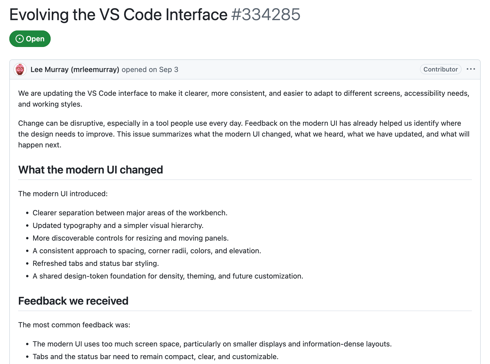
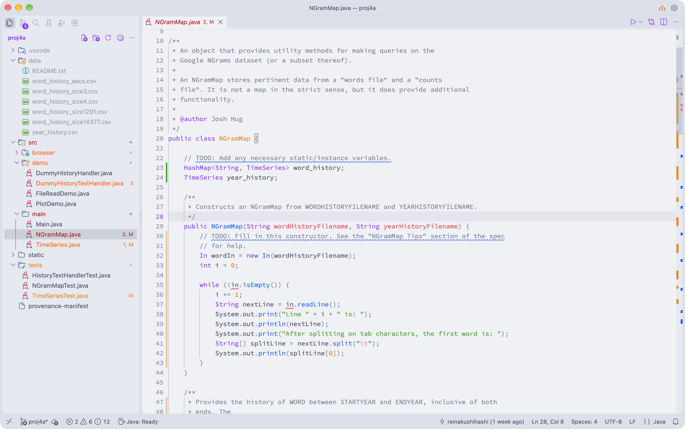
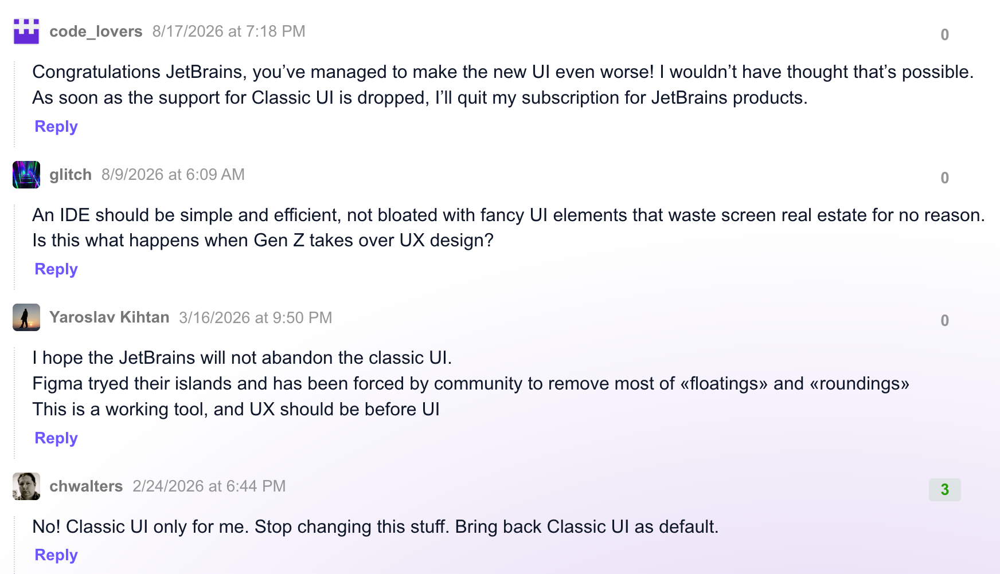
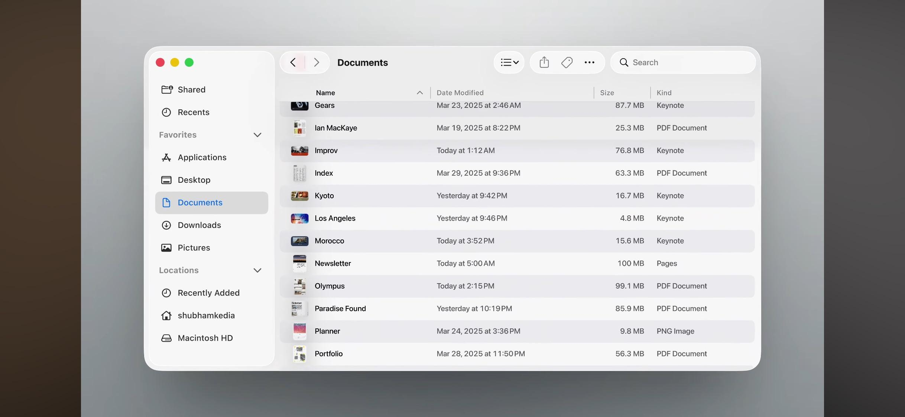
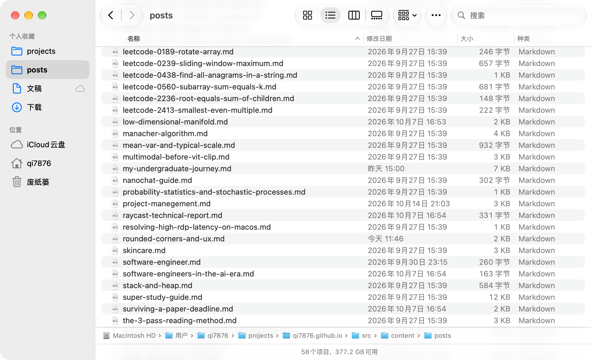
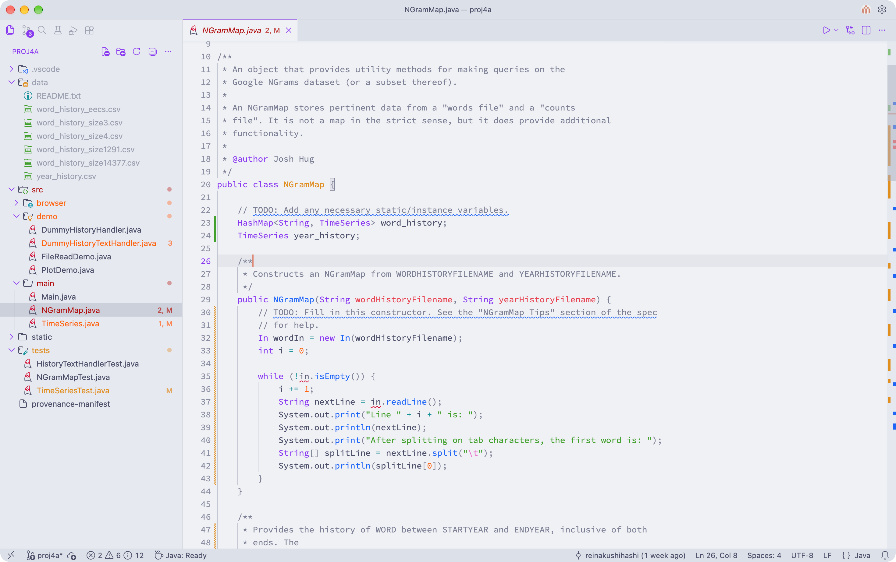

最近 VS Code 更新了界面设计，见 [issue #334285](https://github.com/microsoft/vscode/issues/334285)，让我们看看 VS Code 的开发者是怎么介绍的

说的很好，如果我们暂时忽略下面列出的 Feedback 的话。总之直接进 VS Code 看看吧

WTF，又是这种 UX 灾难垃圾 Islands Theme，这种 IDE 设计风格最初由 Jetbrains 推出，那让我们看看 Jetbrains 的用户怎么说

haha, classic

再让我们看看 VS Code 的 Feedback

> The most common feedback was:
>
> - The modern UI uses too much screen space, particularly on smaller displays and information-dense layouts.
> - Tabs and the status bar need to remain compact, clear, and customizable.
> - Resize affordances and separation between panels need to be discoverable without becoming distracting.
> - Rendering performance needs further improvement.
>
> On a 1920 x 1080 display at 100% zoom, the modern UI currently uses approximately `20px` more horizontal space and `12-18px` more vertical space, depending on layout. The feedback made clear that the initial balance between readability and density did not work for every person or setup.

和 Jetbrains 得到的反馈别无二致

Apple 的设计一向广受赞誉，我们来看看 Apple 怎么做

WTF，更弱智的设计来了，Apple 的设计团队居然能想出把内容放在背景层级，然后把边栏和按钮置于上层，那我打开 Finder 到底浏览的是文件还是边栏？在 macOS 27 上，Apple 终于意识到自己设计出的是一坨屎，然后把 UI 改回来了

所以，让 UI 服务于 UX，而不是凌驾于 UX 之上，搞出一些看起来很 fancy 的东西

